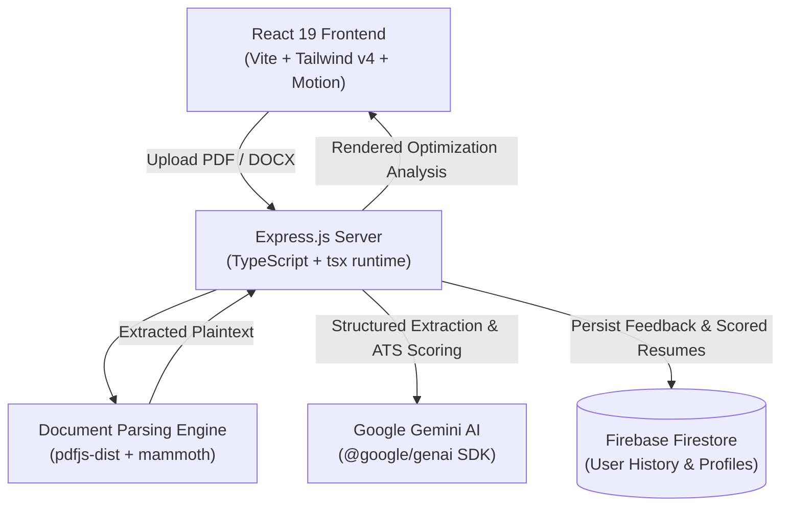

# ✈️ ResumePilot — AI-Powered Resume Enhancer & Job Matching Engine

[](https://react.dev/)
[](https://vitejs.dev/)
[](https://www.typescriptlang.org/)
[](https://expressjs.com/)
[](https://ai.google.dev/)
[](https://firebase.google.com/)
[](https://tailwindcss.com/)

ResumePilot is a modern full-stack web application that uses Google Gemini AI to analyze, score, and optimize resumes for applicant tracking systems (ATS). The platform extracts content from uploaded PDF and DOCX files, computes keyword alignment against target job descriptions, generates tailored cover letters, and persists user resume revisions via Firebase Firestore.

---

## 🏗️ Architecture



---

## 🚀 Key Features

- **Document Ingestion:** Direct client-side and server-side text extraction from PDF (`pdfjs-dist`) and DOCX (`mammoth`) formats.
- **ATS Compatibility Scoring:** AI-driven scoring across readability, action verb density, quantitative impact metrics, and section structure.
- **Job Description Alignment:** Semantic keyword gap analysis comparing candidate resumes against targeted job requisitions.
- **Tailored Outreach Generation:** Automated generation of customized cover letters and recruiter application emails.
- **Session History:** Cloud storage of historical versions and audit logs via Firebase Firestore.

---

## 🛠️ Tech Stack

- **Frontend:** React 19, Vite 6, Tailwind CSS v4, Motion (Framer Motion), Lucide Icons
- **Backend:** Node.js, Express 4, TypeScript, `tsx`
- **AI / LLM:** Google GenAI SDK (`@google/genai` with Gemini models)
- **Document Processors:** `pdfjs-dist` (PDF), `mammoth` (Word DOCX)
- **Database & Auth:** Firebase Firestore & Firebase Auth

---

## 📂 Project Structure

```
ResumePilot/
├── src/                      # React frontend source code
│   ├── components/           # UI components, dropzones, score gauges
│   ├── lib/                  # Firebase & client utility configs
│   ├── pages/                # Analyzer, JobMatcher, CoverLetter views
│   └── App.tsx
│
├── server.ts                 # Express TypeScript backend & Gemini proxy
├── firebase-applet-config.json
├── firestore.rules           # Security rules for Firestore collections
├── package.json
├── tsconfig.json
└── vite.config.ts
```

---

## 🚀 Quickstart & Local Setup

### 1. Clone the Repository
```bash
git clone https://github.com/Narasimhamanam/ResumePilot.git
cd ResumePilot
```

### 2. Configure Environment Variables
Create `.env` using `.env.example`:
```env
GEMINI_API_KEY=your_gemini_api_key_here
PORT=3000
```

### 3. Install & Run
```bash
npm install
npm run dev
# Server and frontend run concurrently at http://localhost:3000
```

### 4. Build for Production
```bash
npm run build
npm start
```

---

## ⚠️ Limitations & Honest Status

- **API Key Dependence:** AI scoring requires an active Google Gemini API key.
- **Parser Limitations:** Complex multi-column graphic resumes or scanned image PDFs without embedded text layers require OCR preprocessing.
